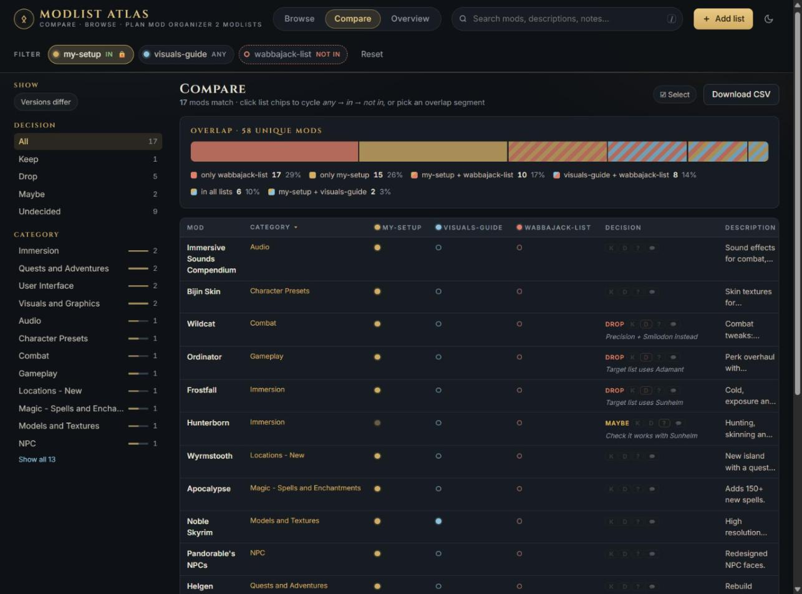
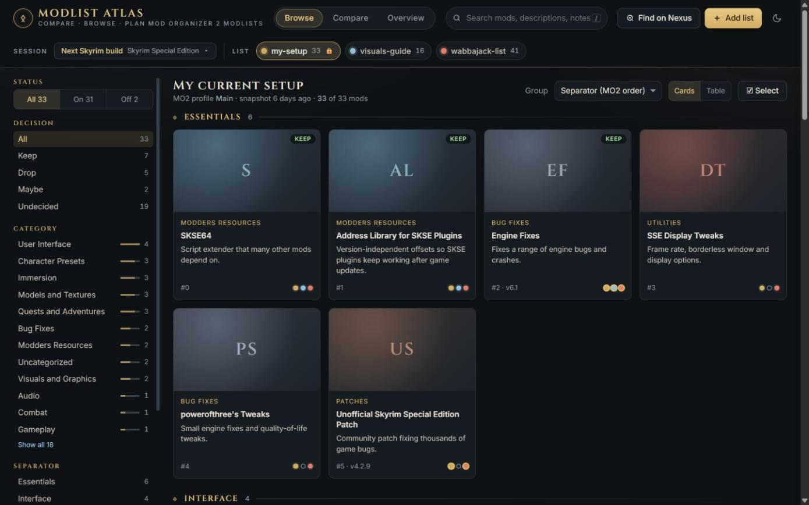
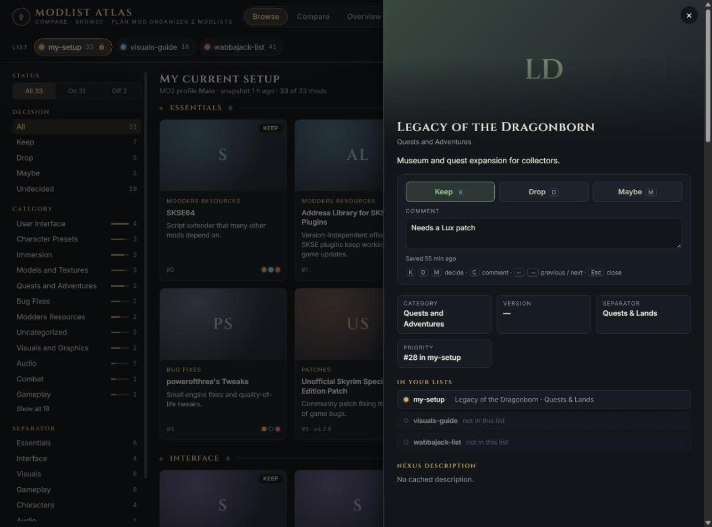
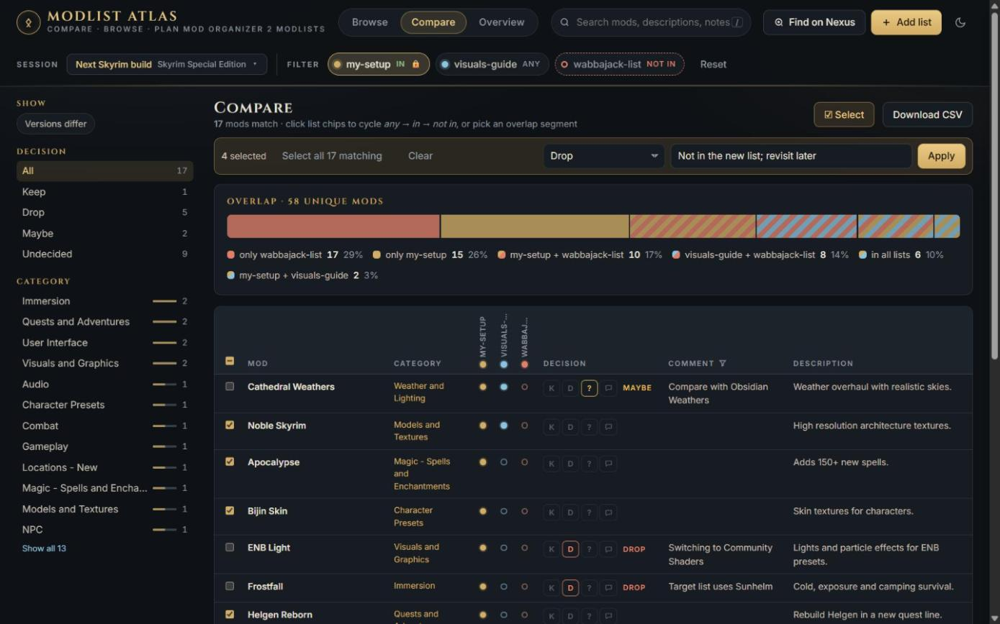
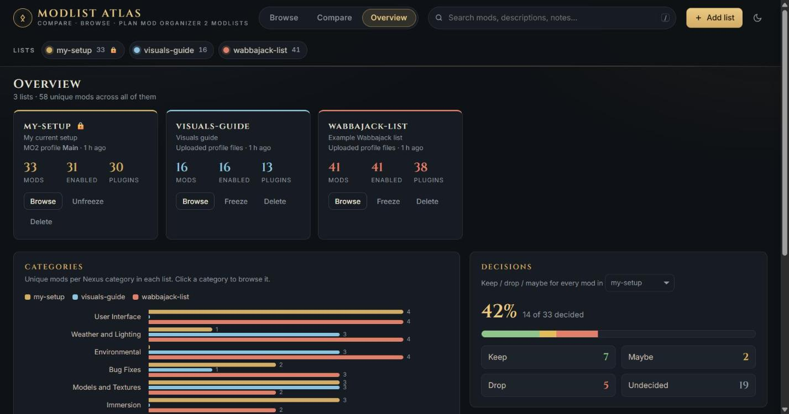

# Modlist Atlas

**Compare · browse · plan Mod Organizer 2 modlists.**

Moving to a new modlist? Modlist Atlas puts your current MO2 setup next to the list you're moving
to (a Wabbajack list, a guide, a friend's profile) so you can see what's shared, what's missing and
what's different. Then you decide, mod by mod or many at once, what to **keep**, **drop** or think
about later.

It runs on your own PC in your browser. It never changes your MO2 install, and it only goes online
when you ask it to: with a Nexus API key, or when you click **Find on Nexus**.



<sub>Screenshots show a small demo with three sample lists.</sub>

## What it helps you answer

- *Which of my mods does the new list already include, and which would I lose?*
- *What does the new list add that I've never used?*
- *Do both lists use the same mod in different versions?*
- *Of the 600 mods in my setup, how many have I decided on so far?*

Works with every game Mod Organizer 2 manages: Skyrim, Fallout, Oblivion, Morrowind, Starfield and
others. Vortex lists aren't supported.

## Quick start

1. Install [Python 3.10 or newer](https://www.python.org/downloads/) (tick *Add Python to PATH*).
   Nothing else is needed.
2. Download this project: **Code → Download ZIP** on GitHub, and unzip it anywhere. Or use git:
   ```powershell
   git clone https://github.com/vivekmtk/modlist-atlas.git
   ```
3. Double-click **`Modlist Atlas.bat`**. Your browser opens `http://localhost:8000`.
4. Click **+ Add list** and pick one:
   - **MO2 profile**: point it at your Mod Organizer 2 folder and choose a profile.
   - **Upload files**: drop in a profile's `modlist.txt` (plus `plugins.txt` and INIs if you have
     them), a whole profile folder, or a `.zip`. Use this for lists you haven't installed, for
     example one shared on Load Order Library or by a friend.

Add at least two lists to compare them. To refresh a list after changing it in MO2, use
**Re-snapshot** on the Overview page.

## A tour

### Compare lists side by side

Every mod gets one row, and every list gets a column. Click the list chips at the top to cycle each
one through *any → in → not in*. For example, *in my-setup, not in wabbajack-list* shows exactly
what you'd lose by switching. Or click a segment of the overlap bar. **Versions differ** finds mods
that both lists have in different versions (only lists snapshotted from MO2 have versions).
**Download CSV** exports the current view, with your decisions, for a spreadsheet.

In tables the column headings stay in view as you scroll. If a table is too wide for the window,
it scrolls sideways in its own frame, with the mod names kept on the left. Your comments have their own column. Click **Comment** in the
header to filter it like in Excel: tick the comments to show (or *(Blanks)* for mods without
one), or search the list and press **OK**.

### Browse a list



See one list as cards or a table. Group mods by MO2 separator (in load order) or by Nexus category,
and filter by category, separator, decision or enabled state. The coloured dots on each card show
which of your lists contain that mod.

### Decide what to keep



Click a mod for its details: its description, a Nexus link, and which lists contain it. Mark it
**Keep**, **Drop** or **Maybe** and add a comment, such as *replaced by Lux* or *needs a patch*.
In tables, the small **K / D / ?** buttons on each row do the same without opening the mod.

Decisions follow the mod, not the list. A mod you marked *keep* shows as *keep* in every list that
has it, and decisions survive re-snapshots and deleting lists.

### Find uploaded mods on Nexus

Uploaded lists only have mod names, so their mods have no Nexus link, category or description
unless one of your MO2 lists has the same mod. Click **Find on Nexus** at the top to search Nexus
for every such name:

- **Exact title, one mod**: linked automatically, e.g. `Vanilla Scripting Enhancements`.
- **Close titles**: kept as suggestions, e.g. `Vanilla Scripting Enhancements - BSA Version` or a
  patch whose name starts like the main mod. The button shows how many are waiting. Open a mod (or
  use the **Needs Nexus review** filter) to **Accept** the right one or choose **None of these**.
- **Nothing found**: tool outputs, renamed or removed mods. Tick *Search again for names that
  weren't found* on a later run to retry only these.

Results are saved, so each name is searched only once, and new lists only search their new names.
A wrong automatic match can be undone from the mod's details. No API key is needed; only mod names
are sent to Nexus.

### Decide on many mods at once



Click **☑ Select** in Browse or Compare to show checkboxes. Tick mods one by one, or use the header
checkbox to select everything matching your filters. Then choose a decision and/or a comment and
click **Apply**. A typed comment replaces the existing comments on those mods. Leave it empty to
keep them.

### See the big picture



The Overview page shows how far along your decisions are, how the lists' categories compare, and
how many mods each pair of lists shares. Click any number to jump to those mods. **Freeze** a list
(for example your current setup) so the app asks before overwriting it.

## Keyboard shortcuts

| Key | Action |
|---|---|
| `/` or `Ctrl+K` | Search |
| `K` / `D` / `M` | Keep / drop / maybe (with a mod open) |
| `C` | Edit the comment |
| `←` / `→` | Previous / next mod |
| `Esc` | Leave the comment box, then close |
| `Enter` | Open the focused table row |

## Optional settings

You don't need any settings for the web app; it asks for everything it needs. To pre-fill the
*MO2 profile* form, or to add a Nexus API key, copy `.env.example` to `.env` and edit it:

```powershell
Copy-Item .env.example .env
notepad .env        # MO2_PATH, MO2_PROFILE, MO2_LIST_NAME, NEXUS_API_KEY
```

**Nexus API key** (nexusmods.com → Site preferences → API Keys): adds official one-line summaries
and thumbnails. Without it, summaries come from the descriptions MO2 has already cached. Results
are cached, so only new mods are looked up. The key is used only for your own lists (personal use,
as Nexus's API policy allows).

## Privacy and safety

- **Read-only towards MO2.** Snapshots copy files out; nothing is ever written back.
- **Offline by default.** Without a Nexus key, it only reads your MO2 folder and the files you
  upload. **Find on Nexus** sends mod names to Nexus only when you click it.
- **Only on your PC.** The server listens on `localhost` only and refuses requests from other
  websites.
- **No personal paths.** Absolute paths and your graphics card name are blanked in copied INIs.

## Where your data lives

Everything stays in the project folder, unless you set `ATLAS_HOME` to use another one:

| Folder | Contents |
|---|---|
| `lists/<name>/` | Snapshots: `MODLIST.md`, `MODLIST_BY_CATEGORY.md`, `LOADORDER.md`, `mods.csv`/`json`, MO2 profile files |
| `plan/` | `decisions.json`: your keep / drop / maybe decisions and comments |
| `data/` | Nexus descriptions read from MO2, Nexus API results, and **Find on Nexus** results and your choices (`nexus_match.json`) |
| `.env`, `.lists.local.json` | Your settings and which MO2 folder each list came from |

Back these up to keep a history. None of them are part of the repository, so updating the tool
never touches them.

## Rebuilding a setup from a snapshot

1. Install MO2 and the game, and create a profile.
2. Copy `lists/<name>/profile/*` into `Mod Organizer 2/profiles/<profile>/` and re-set any blanked
   INI values (such as the screenshot folder).
3. Install each mod from the links in `MODLIST.md`, keeping the **same mod names** (MO2 matches
   `modlist.txt` entries by folder name).
4. Regenerate outputs that aren't on Nexus (for Skyrim: DynDOLOD, xLODGen, TexGen, Grass Cache,
   PGPatcher and similar).

## Good to know

- **Uploaded lists only have mod names.** They're matched to your other lists by name, and borrow
  links, categories and descriptions from them. **Find on Nexus** fills in the rest by title; a
  mod with a very different folder name may still need to be confirmed by hand or won't be found.
  Versions are never known for uploaded lists.
- **Mods without a Nexus ID** (tool outputs, manual installs) have no link or category.
- **Adding lists and saving decisions need the local server** (`Modlist Atlas.bat`). Served any
  other way, the app is a read-only viewer.
- List colours repeat after 8 lists.

## Command line

The same snapshots and imports are available without the web app:

```powershell
python tools/export_modlist.py                                   # snapshot using .env
python tools/export_modlist.py --mo2 "<MO2 folder>" --profile "<profile>" --name <list>
python tools/export_modlist.py --name <list> --freeze            # ask before overwriting
python tools/import_files.py "<profile folder | .zip | files>" --name <list>
python tools/serve.py --port 8123 --no-browser                   # another port, no browser
```

## Development

```powershell
python -m unittest discover tests
```

The tests use a temporary `ATLAS_HOME` and a fake MO2 install; they never touch your data or the
network. See [DESIGN.md](DESIGN.md) for how the pieces fit together.

## Credits and notes

- Built with AI assistance ([Claude Code](https://claude.com/claude-code)); reviewed and directed by
  the author.
- Mod names, summaries, descriptions and images belong to their respective authors on
  [Nexus Mods](https://www.nexusmods.com). This project only links to them and caches them locally.
- Not affiliated with any game publisher, Nexus Mods, Mod Organizer 2, Wabbajack or Load Order Library.

## License

[MIT](LICENSE) © 2026 Vivek Muralidharan
